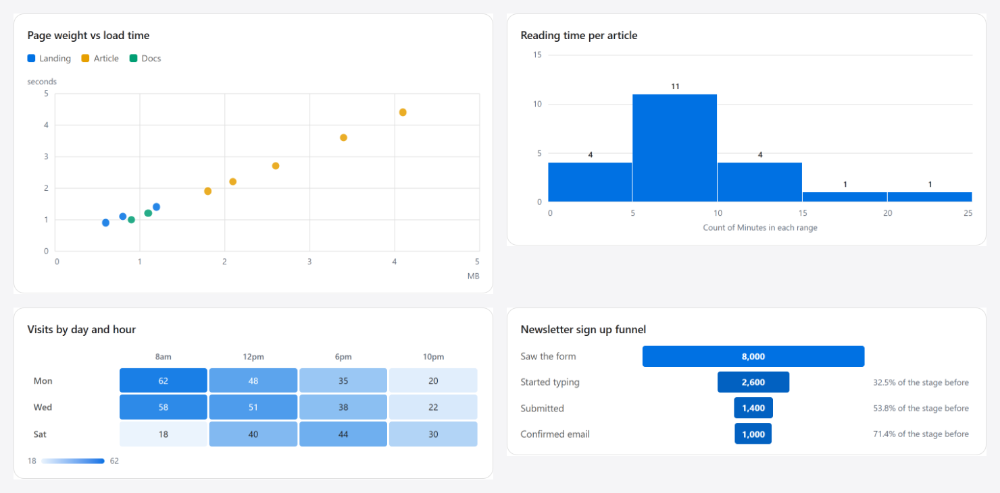
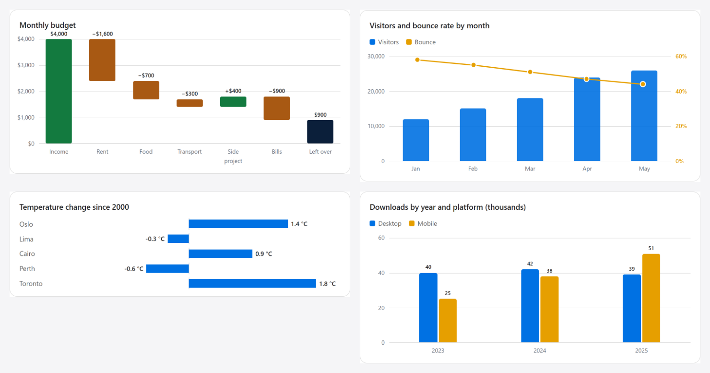

# Folio

**Article blocks and charts for any EmDash site.** Folio adds 13 ready-made blocks to the EmDash editor: charts, tables, steps, metric cards, timelines, pros and cons, verdicts, callouts and more. Authors fill in fields in the admin; Folio turns them into fast, accessible, search-friendly HTML on the server. No chart library, no client JavaScript, no pasted HTML.

Folio is a general EmDash plugin, made for every EmDash site, whatever it publishes: a blog, a docs site, a news site, a review site or a shop's journal. Nothing in it is tied to one site; anything a site may want differently is an option or a CSS variable.





## Why Folio

Long articles need more than paragraphs, and the usual ways of adding the extras all cost something:

- **Pasted HTML** breaks when the theme changes, can't be checked, and is easy to get wrong.
- **Chart libraries** ship tens of kilobytes of JavaScript, draw nothing until the script runs, and often hide the numbers from search engines and screen readers.
- **Screenshots of charts** go stale, can't be read by crawlers or assistive technology, and blur on large screens.

Folio replaces all three with **editor blocks with fields**. The author picks a block from the slash menu and types or pastes the content; the site renders it.

## What you get

- **13 blocks** in the editor's slash menu, under "Folio".
- **13 chart types** in one chart block, drawn by Folio's own code from pasted data (CSV, tabs straight from a spreadsheet, or semicolons).
- **Server rendered HTML and SVG.** Every number is in the page source, so readers, search engines and AI crawlers see the content without running scripts. Nothing to hydrate, nothing to load late.
- **Accessible by default.** Each chart has a written description that screen readers announce, and a "Data table" with every value. Tables keep real table markup.
- **Phone friendly.** Wide layouts turn into stacked cards on small screens; tables become one card per row. Pages never scroll sideways.
- **Structured data from the same fields.** The steps block can produce HowTo markup and the review snapshot produces Review markup, so the schema always matches what is on the page.
- **Checks instead of surprises.** When pasted data doesn't fit a chart (a missing column, text where a number should be, too many slices), the block shows a short note saying why instead of drawing something misleading.
- **Themeable.** Every colour, radius and shadow is a `--folio-*` CSS variable; one rule restyles all blocks.
- **Tested.** Every layout rule is a pure function with unit tests; CI runs the tests and a type check on every change.

## The blocks

| Block | Type name | Use it for |
|---|---|---|
| TL;DR | `folioTldr` | The short version of an article, 3 to 5 points near the top |
| Steps | `folioSteps` | A numbered process; can also produce the page's HowTo markup |
| Callout | `folioCallout` | A tip, a warning or a standout finding, set apart from the text |
| Metric cards | `folioMetrics` | 2 to 4 headline numbers with their source |
| Chart | `folioChart` | Any of the 13 chart types below |
| Table | `folioTable` | A comparison table from pasted rows, with an optional highlighted column |
| Timeline | `folioTimeline` | Dated events in order |
| Pros and cons | `folioProsCons` | What's good and what's not, side by side |
| Verdict | `folioVerdict` | A stated pick, why, and the catch |
| Choose A or B | `folioChoose` | Who should pick each of two options |
| Who it's for | `folioAudience` | Who something suits and, always, who it doesn't |
| Review snapshot | `folioSnapshot` | A review's verdict card: score, key stats, score rows; produces Review markup |
| Sale calendar | `folioSaleCalendar` | Recurring sales or events whose next dates and status update by themselves every year |

## The chart types

| Chart | Shows |
|---|---|
| Bars | Amounts compared or ranked; grouped by series; values below zero diverge from a zero line |
| Columns | A few periods side by side, single or grouped |
| Line | Change over time, up to 6 lines, with gaps for missing values |
| Area | A total over time, or up to 4 areas stacked |
| Stacked bars | Parts of a whole across groups, as totals or as 100% shares |
| Donut | Parts of one whole, up to 6 slices |
| Comparison | Two values per row (before and after), sorted by the change |
| Scatter | Two measures against each other, coloured by group |
| Histogram | How one set of values is spread, in equal round ranges |
| Heatmap | A grid shaded by value |
| Funnel | How many make it through each stage |
| Waterfall | Changes adding up to a total |
| Bars plus a line | Two measures with different units, each on its own axis |

Axes use round steps, labels never shrink on phones, and colours follow a colour-blind-safe palette after your accent colour.

## Install

Requires `astro` 7.3 or later and `emdash` 1.4 or later (peer dependencies). Folio ships its TypeScript and Astro source; your site's Astro build compiles it, so there is no build step.

Install a release tag from GitHub:

```sh
npm install github:couponzania/emdash-folio#v0.7.1
```

Register it in `astro.config.mjs`:

```js
import { defineConfig } from "astro/config";
import emdash from "emdash/astro";
import { folioPlugin } from "emdash-folio/plugin";

export default defineConfig({
  integrations: [
    emdash({
      plugins: [folioPlugin()],
    }),
  ],
});
```

That's all: the blocks appear in the editor's slash menu, and every `<PortableText>` renders them.

### Options

```js
folioPlugin({
  // Link prefixes that count as paid or affiliate links. A review snapshot button whose link
  // starts with one gets rel="sponsored nofollow noopener noreferrer". Default: none.
  paidLinks: ["/go/", "https://"],
});
```

### Styling

Every colour, radius and shadow is a `--folio-*` variable, and every class starts with `folio-`. The defaults sit under `:where(.folio)`, so one plain rule in your own CSS overrides them:

```css
.folio {
  --folio-accent: #0b6bcb;     /* buttons, first chart series, highlights */
  --folio-text: #1d1d1f;
  --folio-surface: #ffffff;    /* card backgrounds */
  --folio-border: #e0e0e0;
  --folio-radius: 8px;
  --folio-radius-lg: 14px;
}
```

The full list is at the top of `src/styles/folio.css`. Folio is designed for light themes.

### Structured data

Folio gives you the schema pieces; your site adds them to its own JSON-LD with the page's url, author and dates.

```ts
import { SNAPSHOT_TYPE, snapshotReview } from "emdash-folio/review-snapshot";
import { STEPS_TYPE, stepsHowTo } from "emdash-folio/steps";

const review = body.find((b) => b._type === SNAPSHOT_TYPE);
const reviewLd = review ? snapshotReview(review) : null; // itemReviewed, reviewRating, reviewBody

const steps = body.find((b) => b._type === STEPS_TYPE);
const howToLd = steps ? stepsHowTo(steps) : null; // name, totalTime, step[]
```

Whether a search engine shows anything special for this markup is its own decision; Folio makes sure the markup is correct and matches the page.

## Versions

Folio follows semver; every release is a `v{version}` tag with notes in [CHANGELOG.md](CHANGELOG.md). Pin a tag in your `package.json` and move to a new one when you are ready.

## Working on Folio

```sh
npm install
npm test            # unit tests (Node's test runner)
npm run typecheck   # astro check
```

- **No ties to any site.** Nothing in Folio imports from a host site; site differences are options or CSS variables. Folio uses only EmDash's public API.
- **Server rendered, no client script** unless a block truly needs one.
- **Schema from fields.** Structured data is built from a block's fields, never by reading HTML.
- **Tested.** Layout and validation rules live in `rules.ts` files with tests in `tests/`.
- **Versioned.** Every code change bumps the version in `package.json` and `FOLIO_VERSION` in `src/plugin.js` and adds a `CHANGELOG.md` entry; a test fails if they disagree.

Issues and pull requests are welcome.

## Licence

MIT. See [LICENSE](LICENSE).

## Block reference

Every field of every block, what it accepts, and what happens when the input does not fit.

### Sale calendar (`folioSaleCalendar`)

A brand's sales in calendar order. Each row stores a recurring window; the next dates and status are worked out for the site's calendar day (EmDash's timezone setting) when the page renders, so the table rolls into next year by itself.

| Field | Notes |
|---|---|
| Sale name | Required; a row without one is skipped. |
| Usually runs | `16 Jul to 31 Jul` (a fixed window; may cross new year, `20 Dec to 5 Jan`), `around 25 Dec` (always Expected, never Live), or `not regular: {text}` (shown as is; next dates read Not announced). Short forms `07-16..07-31`, `~12-25` and `none: {text}` also work. Anything else is shown as text, never guessed. |
| Best for | One short phrase under the name. |
| Link | Optional: `#anchor`, `/path` or `https://…`. Anything else is dropped. |

Status: **Live now** inside a fixed window, **Expected** before it (or for an "around" day), **Not announced** with no regular window. 29 Feb becomes 28 Feb outside leap years. Pages are cached for up to a day, so a status can lag by that much.

Wide screens get a table; phones get one card per sale, with no sideways scroll.

### Review snapshot (`folioSnapshot`)

The verdict card right after a review's intro. Its fields also make the page's Review markup (`snapshotReview()`, used by the site's `blog-schema.ts`), so the card and the schema always agree.

| Field | Notes |
|---|---|
| What is reviewed | The name in the Review markup (`itemReviewed.name`). No name, no Review markup. |
| It is a | Store, brand or company (`Organization`), Product, or Software or app (`SoftwareApplication`). |
| Verdict | One sentence that names the item; it stands alone if a search result lifts it. Also the Review's `reviewBody`. |
| Overall score | Out of 10, one decimal. Blank: the average of the score rows. Outside 0 to 10: ignored. |
| Key stats | 3 or 4 value and label pairs. A row missing either half is skipped. |
| Score rows | 2 to 4 criteria with a score out of 10 ("9.7" or "9.7/10"). The bars are drawn from the score. |
| Skip it if | A real, specific disqualifier from the review. |
| Checked, note | "November 2026", and an optional note such as "30 day money back". |
| Main button, second link | Optional label and link pairs (`#anchor`, `/path` or `https://…`). Links under a `paidLinks` prefix get `rel="sponsored nofollow noopener noreferrer"`. |

Review markup: `itemReviewed` (type and name), `reviewRating` (the overall score, best 10, worst 0) and `reviewBody`; the site adds the review's id, url, author, publisher and dates. Whether Google shows review stars is Google's call; don't promise them.

### Chart (`folioChart`)

Thirteen chart types from pasted data, drawn on the server by Folio itself (no chart library). Every chart carries its description for screen readers, a data table behind a "Data table" toggle, an optional note and a linked source.

| Field | Notes |
|---|---|
| Chart | **Bars** to compare or rank amounts (horizontal, so labels stay readable on phones; with any value below zero they diverge from a zero line), **Line** for change over time, **Donut** for parts of one whole (up to 6 slices, no negatives). |
| More charts | **Columns** for a few periods (up to 12; a series column groups up to 4 side by side). **Stacked bars** for parts of a whole across groups (a series column, up to 6 parts; "Stacked bars show" picks totals or 100% shares). **Area** for a total over time (a series column stacks up to 4; every series needs a value at every point). **Comparison** for before and after per row (a series column with exactly two values; rows sorted by the change). |
| Analysis charts | **Scatter** for two measures against each other (numbers in both columns; a series column colours the dots; at least 3 points). **Histogram** for how one column's values spread (no label column; equal round ranges, the bins field or an automatic count). **Heatmap** for a grid shaded by value (the x column across, the series column down; up to 12 by 20; empty cells blank). **Funnel** for stages people drop out of (up to 8, each with its share of the stage before). **Waterfall** for changes adding up to a total (each row is a change, the first usually the starting amount; a closing total bar; up to 12). **Bars plus a line** for two measures with different units (the value column as columns, the line column on its own right axis; up to 12). |
| Stacked bars show | Totals (longer bars for bigger totals) or Shares (every bar 100%). Stacked bars only. |
| Column for the line, its unit | Bars plus a line only. |
| Unit along the bottom | Scatter only, e.g. `$` or `%`. |
| Number of ranges | Histogram only, 2 to 30. Blank: chosen from the number of values. |
| Label of the final bar | Waterfall only. Default "Total". |
| Title | Shown above the chart. |
| What it shows | Required. One sentence with the finding; screen readers read it as the chart. |
| Data | CSV, tab separated (pasted from a spreadsheet) or semicolon separated. The first row names the columns. Values may carry thousands separators, a leading currency sign or a trailing %. Up to 500 rows. |
| Column for the labels / along the bottom | The x column, matched without regard to case. On a line, numbers (years) are spaced by value, text evenly in row order. |
| Column of values | Must be numbers. Lines allow empty cells (a gap); bars and donuts don't. |
| Series column | Optional: up to 4 series for bars (grouped), 6 for lines. |
| Unit | `%`, a currency sign (`$`, `₹`, `€`, `£`, `¥`) or a word (`million`). |
| Note, source, source link | Under the chart. Every chart of real data should name its source and date. |

A chart that can't be drawn shows a short note saying why, and logs it. Layout comes from fixed formulas in `src/chart/rules.ts` (nice axis ticks, bar widths, line positions on a 1000 by 1000 plot, donut arcs), all tested.

### TL;DR (`folioTldr`)

The short version near the top of an article. **Title** (default "The short version") and **Points**, one per line (3 to 5; at most 6 are shown). A leading `-`, `*`, `•` or `1.` typed out of habit is removed.

### Steps (`folioSteps`)

A numbered process. **What the steps do** (the title), **Total time in minutes** (optional, whole minutes, shown as "about 2 minutes") and the **Steps** (a name and what to do; at least 2). Its fields also make the page's HowTo markup:

```ts
import { STEPS_TYPE, stepsHowTo } from "emdash-folio/steps";
const howTo = node ? stepsHowTo(node) : null; // @type HowTo, name, totalTime (PT2M), step[]
```

No title or fewer than 2 steps, no HowTo. Whether Google shows anything for HowTo is Google's call.

### Callout (`folioCallout`)

**Kind**: Tip (non obvious advice), Warning (a real risk) or Insight (a standout finding), each with its own colour and default title ("Tip", "Watch out", "What we found"). **Title** (optional) and **Text**.

### Metric cards (`folioMetrics`)

2 to 4 headline numbers. Each **card** has a number, what it is, and optional context; a card missing the number or the label is skipped. **Source** and **Source link** go under the cards. Two cards across on phones.

### Timeline (`folioTimeline`)

Dated events, shown in the order typed (dates are shown as written, never sorted or guessed). Each **event** has a date, what happened, and optional detail. Dates sit beside the line on wide screens and above each event on phones.

### Table (`folioTable`)

**Rows** pasted like chart data (CSV, tabs from a spreadsheet, or semicolons). The first row names the columns and the first column names the rows. 2 to 5 columns (keep to 4 unless every cell is very short) and up to 50 rows. **Column to highlight** marks one column as the pick. **Caption** goes under the table. On phones every row becomes a card whose cells carry their column name, so nothing scrolls sideways. A table that can't be shown says why.

### Pros and cons (`folioProsCons`)

**Pros** and **Cons**, one per line, with optional headings (default "What's good" and "What's not"). Shown only when both lists have items.

### Verdict (`folioVerdict`)

A stated position for comparisons and best lists (reviews use the review snapshot): **Our pick** in one sentence (required), **Why**, and **The catch**. Optional label (default "Our verdict").

### Choose A or B (`folioChoose`)

Two cards: each option's name ("Choose {name} if") and its reasons, one per line. Both sides need reasons.

### Who it's for (`folioAudience`)

**Good for** and **Not for** lists, one per line, with optional headings. The "not for" list is required: a block without it isn't shown.
